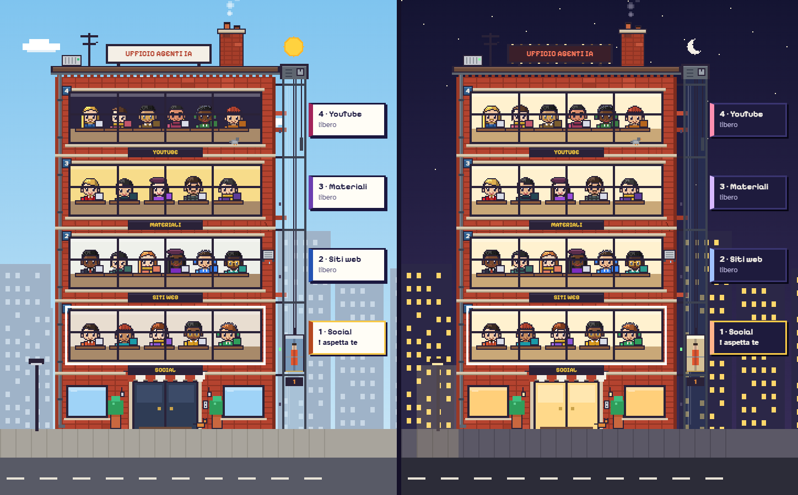
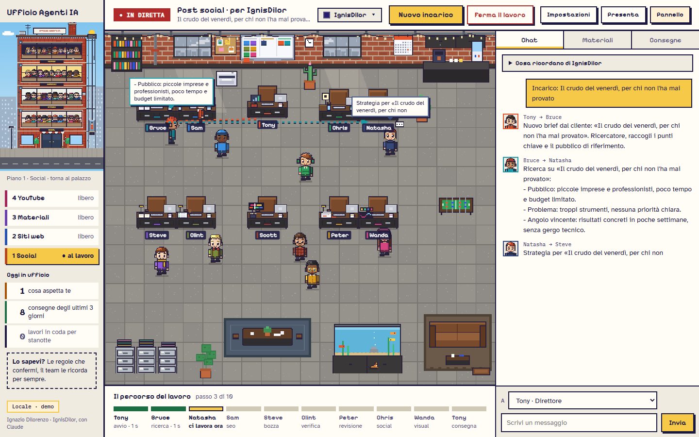
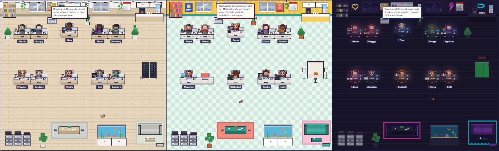

# Ufficio Agenti IA

**Un'agenzia di contenuti fatta di agenti IA, in un ufficio in pixel art, che lavora tutta sul tuo computer.**

Assegni un incarico, il team lo scrive, lo rivede e lo consegna: post, reel, siti, grafiche, video YouTube.
Senza abbonamenti, senza mandare i tuoi file a nessuno.

&nbsp;

 

Il palazzo dell'ufficio, di giorno e di sera: segue l'ora del tuo computer. Immagini della prossima versione.

> **English in short.** Ufficio Agenti IA is a free Windows app where a team of AI agents works together in a
> pixel-art office to produce content for small local businesses: social posts and reels, websites, branded
> graphics and faceless YouTube videos. Everything runs locally with [Ollama](https://ollama.com) (we recommend
> Gemma 4): no subscription, no cloud, your files never leave your computer. The app is in Italian.

---

## Cos'è

Un ufficio con **quattro piani**, ognuno con il suo team. Gli agenti si passano il lavoro, si correggono a vicenda e
tu li vedi muoversi tra le scrivanie in tempo reale. Prima di consegnare, il capo del piano rilegge tutto.

| Piano | Cosa fa |
|---|---|
| **1 · Social** | Post, caroselli, reel, storie, newsletter e piani editoriali, con il marchio del cliente (colori, logo, caratteri, foto) e il montaggio dei video |
| **2 · Siti web** | Siti nuovi pronti da pubblicare e analisi di siti esistenti, con check-up, SEO e GEO |
| **3 · Materiali** | Foto nei formati di ogni social, grafiche col marchio, sottotitoli automatici, immagini create dall'IA |
| **4 · YouTube** | Video lunghi e Shorts senza volto: copione, voce narrante, immagini, montaggio, miniature, titoli e descrizione |

Ogni cliente ha la sua scheda (tono, cose da usare e da evitare, colori) e i suoi materiali: il team li usa
come fonte e non inventa dati.

## Come funziona

1. **Scegli il cliente** e premi «Nuovo incarico». Scrivi (o detti) di cosa parla e che formato ti serve.
2. **Il team si mette al lavoro.** Vedi gli agenti alzarsi, passarsi i fogli e scriversi in chat. In basso, «Il
   percorso del lavoro» ti dice a che punto sono.
3. **Il capo del piano rilegge tutto** e corregge solo errori veri, citando la frase sbagliata.
4. **Ricevi la consegna**: il file finito, il testo da copiare e i pulsanti per cambiare quello che non ti piace.

  
   Il piano Social al lavoro su un post: a destra la chat del team, in basso il percorso del lavoro.

## Perché è diverso

- **Tutto in locale.** Il modello gira sul tuo computer con Ollama: i materiali dei clienti non vanno su nessun server.
- **Gratis.** Nessun abbonamento e nessun costo a contenuto.
- **Un team, non un prompt.** Ricercatore, copywriter, editor, art director, controllo finale: ognuno fa la sua parte e
  chi viene dopo controlla chi c'era prima.
- **Pensato per le attività locali.** Ristoranti, negozi, professionisti: testi in italiano, inviti all'azione veri
  (chiama, prenota, scrivi su WhatsApp), niente frasi fatte.
- **Pronto da pubblicare.** Il risultato è un file finito (video, immagine, sito, pacchetto YouTube) nella cartella del cliente.

## In arrivo nella prossima versione

La versione che scarichi oggi ha i quattro piani e tutto il piano Social rifinito. La prossima è quasi pronta
(si sta facendo l'ultima revisione) e porta:

- **Una grafica nuova, «Palazzo in regia».** All'apertura vedi il palazzo e cosa è successo mentre eri via: cosa
  aspetta te, cosa è in corso, cosa è pronto. Ogni piano ha il suo ufficio, con il suo arredamento.
- **Prima volta guidata.** L'app guarda il tuo computer, sceglie il modello giusto e installa da sola Ollama e Gemma.
- **Memoria.** Il team ricorda le regole che confermi («mai emoji per questo cliente») e i fatti verificati di ogni
  cliente. Le note si aprono anche in Obsidian.
- **Lavori di notte.** «Fallo stanotte» mette l'incarico in coda: parte all'una e al mattino trovi tutto pronto.
- **Siti per settore**: sette stili diversi che non si ripetono, anteprima da mandare a un potenziale cliente con
  scadenza e messaggi di primo contatto già scritti.
- **Grafiche col marchio vero** in quattro misure (quadrata, verticale, orizzontale, storia), controllate da un agente
  che guarda le immagini.
- **Video YouTube montati con HyperFrames**: immagini a tema scelte e controllate, voce narrante, effetti sonori con
  licenza libera, miniature, capitoli e Shorts. Se il montaggio si ferma, riparte da dove era.

  
   Gli uffici dei piani Siti web, Materiali e YouTube nella nuova grafica.

## Requisiti

- **Windows 10 o 11** a 64 bit.
- **[Ollama](https://ollama.com)** con un modello: consigliato **Gemma 4** (`ollama pull gemma4:26b`; con meno memoria
  `gemma4:12b`). Ollama è gratuito.
- **[Node.js](https://nodejs.org)** per montare reel, caroselli e video (l'app avvisa se manca).
- Facoltativi, si scaricano dall'app quando servono: sottotitoli automatici (circa 200 MB), immagini create dall'IA
  (circa 13 GB, serve una scheda video NVIDIA da almeno 6 GB), voce IA italiana (circa 90 MB).

Python e FFmpeg sono già dentro l'installer.

## Installazione

1. Scarica `UfficioAgentiIA-Setup-….exe` dalla [pagina delle versioni](https://github.com/dilorenzoservice/ufficio-agenti-ia/releases/latest).
2. Doppio clic e «Installa». Non servono permessi da amministratore.
3. Apri **Ufficio Agenti IA** dal desktop o dal menu Start.

Clienti, materiali e consegne stanno in **Documenti\Ufficio Agenti IA** e restano anche se disinstalli.
Quando esce una versione nuova, nell'app compare il pulsante **Aggiorna**: un clic e si aggiorna da sola.

## Domande frequenti

**Windows dice «Windows ha protetto il PC».** Il programma non ha una firma digitale a pagamento. Clicca
«Ulteriori informazioni» e poi «Esegui comunque».

**Serve Internet?** Solo per scaricare l'app, il modello e gli strumenti facoltativi. Le ricerche sul web degli
agenti partono solo se le approvi tu, una per una.

**Quanto è veloce?** Dipende dal computer: con una scheda video da 12 GB un post richiede circa un minuto, un sito
qualche minuto, un video YouTube di 10 minuti più di un'ora (quasi tutta per la voce narrante e il montaggio).

**È gratis anche per lavoro?** Sì, l'app si scarica e si usa gratis, anche per i tuoi clienti. Il codice sorgente
non è pubblico.

**Dove segnalo un problema?** Apri una [segnalazione](https://github.com/dilorenzoservice/ufficio-agenti-ia/issues)
e allega `Documenti\Ufficio Agenti IA\ufficio.log`.

---

Fatto da **Ignazio Dilorenzo · [IgnisDilor](https://www.ignisdilor.it)**, con Claude.

*Non creo siti belli, creo sistemi che portano clienti.*

